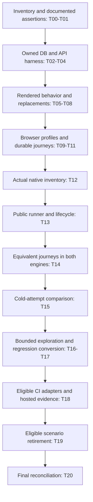

# Testing structure, Maestro pilot, and agent exploration implementation plan

Status: Implementation in progress under BL-018/D-219. See `docs/qa/testing-modernization-task-card.md` for per-phase evidence. This plan alone establishes no tooling migration, CI promotion, test result, or product behavior change.

Date: 2026-09-28. Owners: MyChampions client and sibling MyChampions server. Execute the phases in order; use the exit criteria to decide whether the next phase can start.

Planning revision: this document is the implementation specification. Its status line reflects existing workspace work; this revision authorizes no additional runtime changes or external delivery. Consult the task card and fresh receipts before deciding which tasks already pass. Section 15 provides bounded implementation tasks; Sections 16–18 specify runner contracts, unresolved behavior, and an implementer handoff.

### Start here

For the compact work order, resume procedure and copyable implementation prompt,
read the [implementation entry point](2026-09-29-testing-modernization-start-here.md).
This specification continues to own acceptance; the task card owns progress.

The tooling decision is conditional: retain Node/Bun, rendered component tests and Playwright; compare Maestro against retained Detox coverage; use agents for bounded discovery and convert confirmed findings into deterministic regressions. Installing Maestro alone does not resolve test structure or backend-proof gaps. Experimental AI assertions are not release gates.

An implementer should read Sections 2–3 for authority and workspace rules, Section 19 for the resume procedure, then select the earliest task in Section 15 whose prerequisites have current evidence. Read that task's phase specification and Section 16 before editing. Section 18 is the copyable implementation prompt. Section 20 is the final review rubric for each task. Section 21 breaks the remaining native work into small implementation packets. The task card owns progress; this plan owns requirements.

The [implementation handoff](2026-09-29-testing-modernization-implementation-handoff.md)
provides concrete review units, existing versus planned commands, a copyable
execution prompt and decision handling. Start with its Section 0 dispatch card
to choose one ready packet, reuse existing work and separate preparation from
runtime and hosted acceptance. Its Section 10 records the owner decision of 2026-10-03: native logout clears
only the device-local persisted credential/session and identity. Signed-out
relaunch and protected UI checks remain required; server bearer revocation is
outside native acceptance. Browser revocation remains unchanged. No phase is
complete merely because this policy is resolved.

Handoff Section 11 gives the task-selection algorithm and T16 Maestro MCP
qualification steps. Use it to resume existing work and verify the agent's
actual target before exploratory actions; connector availability is not a
passing regression or an adoption decision.

Handoff Section 13 provides executable work orders: existing files to reuse,
a complete training action/assertion recipe, runner rejection cases, an
exploration example and the required report. Start with that section when
turning a selected task into edits. Its examples supplement the existing
requirements; they do not introduce product behavior or passing evidence.

Do not restart from P0 just because this is a new agent session. Do not skip to Maestro because it is the requested tool. Existing files must be inspected and reused; historical evidence must be checked for freshness. A passing shell exit alone does not establish that all requested cases, assertions and cleanup ran.

### Reading order and decision map

For a fresh implementer, use this order rather than reading every historical
report before choosing a task:

1. Read the task card's Status and Acceptance matrix, then this document's
   Sections 2–4. This establishes ownership, authority and command contracts.
2. Select a task from Section 15 using the handoff's Section 11 algorithm.
   Read only that task's prerequisites, phase specification and linked domain
   requirements. Verify the relevant receipts against current inputs.
3. Fill the Section 19 worksheet. For T12–T15, use the Section 21 packets
   and the matching handoff work order. For the Android continuation, the
   entry point's Section 6 supplies recovery and runtime qualification packets;
   handoff Section 14 supplies reusable lifecycle details. Section 12
   retains an earlier observation recipe, not the current dispatch.
4. Implement and validate one packet. Apply Section 20's rejection rules;
   update the existing task card before selecting the next packet.
5. At T20, assess every Section 12 criterion. A recommendation to retain
   Detox is a valid comparison outcome; missing comparison evidence is not.



The diagram is the default delivery order. T18 may wire an independently
qualified earlier lane before the native comparison finishes, as Section 11
allows. It may not promote an unqualified native lane. T19 can conclude
“retain” without deleting anything; every retirement still needs its own
comparison and hosted receipts.

Definitions used throughout the plan:

| Term                  | Exact meaning                                                                                                                     |
| --------------------- | --------------------------------------------------------------------------------------------------------------------------------- |
| Family                | A product journey such as training; it contains distinct branches.                                                                |
| Scenario              | One documented starting state, action sequence and required assertion set.                                                        |
| Cell                  | One scenario × engine × platform × data mode; report it independently.                                                            |
| Cold attempt          | A new linked attempt with reset app/fixture state; build reuse is allowed only with matching immutable inputs.                    |
| Inventory observation | A reviewed screen/tree on a verified target; it proves neither a transition nor a completed journey.                              |
| Integrated evidence   | Normal app/API actions against owned real Postgres, independently checked where required.                                         |
| Current receipt       | Actual execution evidence whose source, requirement, fixture, flag, build and tool fingerprints match the inputs being qualified. |
| Promotion             | Making an already proven lane part of the protected hosted matrix; installing a tool does not promote it.                         |

The task card alone selects the current resume point. Earlier P0–P3 results,
T12 observations and bounded T13 controls must be checked against their exact
inputs before reuse. This planning refresh checks documentation and interfaces,
not those runtime results. Do not choose a task from a historical “next” paragraph
or repeat a delivered observation merely because this is a new session.

## 1. Outcome and scope

Build a testing system that proves domain behavior, rendered interactions, durable backend changes, browser journeys, and native journeys separately. Pilot Maestro against Detox before deciding which native scenarios to migrate. Add bounded agent exploration that produces reproducible findings and permanent regression tests.

Keep Node/tsx for client logic, Bun for server tests, and Playwright for browser tests. Add React Native Testing Library (RNTL) for selected rendered components. Keep Detox during comparison and retain specialized provider tests until equivalent replacements are separately proven. Maestro starts as an explicit local/manual pilot, not a new required PR check.

No application database schema or public API changes are expected. Use existing migrations and public app APIs. If a missing product capability is discovered, record it separately; do not implement undocumented behavior to finish the testing work.

Not included: Firebase runtime restoration; paid cloud subscriptions; production data; real purchases; automatic issue posting; autonomous visual-baseline approval; a Pact Broker; replacing every existing test; a whole-product coverage claim; new scheduled automations; release/deployment/store acceptance.

## 2. Verified starting point and authority

Inspection baseline, not an execution result:

- Client HEAD: `9d0c3f4862e6c8b8004fd3378f9d6897ae46493e`; server HEAD: `c7b5191352109f9ce2829b2b8fafcc8f554cf8a7`. The client checkout was dirty. Refresh these facts before implementation; do not assume HEAD contains the inspected working-tree changes.
- `package.json` uses Expo 54, React 19.1, React Native 0.81.5, Yarn 1.22.22, Node/tsx tests, Jest/Detox, and Playwright. The server uses Bun 1.3.10 and Postgres/Drizzle.
- A filename/content scan found 150 feature test files, 57 with source-reading assertion patterns; this is a candidate inventory, not a classification of all assertions. There are 31 native Detox specs, 26 Playwright specs, and 17 root Playwright configs. No `.maestro/` suite exists.
- `playwright.config.ts` enables many app fixtures. `playwright.server.config.ts` launches `../server/scripts/web-e2e-server.ts`, which uses memory-backed repositories and rejects many domain writes. Its real HTTP/session coverage is valuable but does not prove Postgres persistence.
- Some `server/tests/postgres-*.test.ts` files default to a shared local database and truncate tables. Isolate and guard them before running the broad server suite.
- The current trusted PR workflow uses `--platform-scope web-only`. `detox-protected-full.yml` handles manual, published-release, and release/hotfix push validation. The tech-stack specification, pending-wiring checklist, QA adapter, and portions of backlog/decisions need reconciliation with this configuration. Do not infer hosted enforcement from checked-in YAML.

Read before changes: `AGENTS.md`; `docs/discovery/{prioritized-backlog-v1,decisions-log-v1,open-questions-v1,pending-wiring-checklist-v1,backend-provider-migration-v1}.md`; `.agents/qa-project-context.md`; `docs/specs/mobile-nfr-tech-stack-spec.md`; `docs/test-cases/{selective-feature-test-execution,web-playwright-batches-and-manual-validation,qa-env-registry,qa-manual-run-playbook}.md`; `docs/qa/test-gap-sweep.md`; affected screen/FR/UC/AC/BR/TC documents.

Core behavior sources: `FR-001-domain-role-and-care-plans.md`, `UC-002-role-onboarding-and-care-management.md`, `AC-002-role-journeys-and-plan-ownership.md`, `BR-002-role-assignment-and-plan-governance.md`, `TC-002-role-and-assignment-controls.md`, `SC-208-training-plan-builder.md`, and `TC-304-support-message-validation.md`. Resolve the auth, invite, permission, and error expectations from their linked documents before authoring assertions.

Documentation disagreements are decisions to resolve, not permission to change expectations to match current code. BL-016 and D-193/D-195 remain separate CI selection/trust work; this plan does not close their pending evidence gates.

## 3. Execution rules for an implementing agent

1. Re-read this plan, repository instructions, and current status. List the phase being executed and its prerequisites.
2. Preserve all pre-existing changes, including untracked `.qa/`, `.agents/`, test results, and dirty documentation. Inspect attached worktrees before creating managed owner-repository worktrees. Agree the base from current project context; do not silently discard relevant working-tree changes or start from a stale base.
3. Work in the owning repository. Server code belongs in `/Users/eduwaldo/Projects/MyChampions/server`, not a new client-side backend. Read any ancestor/server instructions before server changes.
4. Implement one phase as a reviewable change. Do not add unrelated refactors. Do not commit/push/merge/deploy unless the implementation request authorizes that delivery step. When committing, inspect the latest three commits and follow repository ticket/commit conventions.
5. Use the named files below unless an existing equivalent already exists. Record every path substitution in the phase report; avoid duplicate harnesses.
6. Record validation command, actual result, exact repo/build identity, and evidence. A proposed command or generated manifest never counts as an executed test.
7. On a missing credential, unavailable device, unknown behavior, or unsafe data target, block only the dependent branch. Continue independent tasks. Never substitute fixture evidence for integration/native/provider evidence.
8. Update affected documentation and traceability in the same change. End with a phase completion report and outstanding blockers. Do not label the full plan complete until Section 12 passes.

## 4. Test layers and stable command interface

These commands are TARGET interfaces. Some now exist in the working tree; inspect package scripts and phase receipts before using them. An existing script does not establish a passing phase. Keep existing scripts as compatible aliases until their callers are updated.

| Layer                | Target command                                                                                            | Required behavior                                                                           |
| -------------------- | --------------------------------------------------------------------------------------------------------- | ------------------------------------------------------------------------------------------- |
| Logic/architecture   | client `yarn test:unit`                                                                                   | Retain current Node tests; label architecture checks separately in inventory                |
| Rendered components  | client `yarn test:component`                                                                              | Jest + compatible Expo/RNTL setup; excludes Detox and Node suites                           |
| Default local checks | client `yarn test:all`                                                                                    | Unit + component; no browser/device/provider startup hidden inside it                       |
| Fixture browser      | existing `yarn test:e2e:web:*`                                                                            | Fast deterministic UI checks; receipts identify fixture mode                                |
| Memory-backed HTTP   | existing `yarn test:e2e:web:server`                                                                       | Preserve current session tests; explicitly identify memory persistence                      |
| Integrated browser   | client `yarn test:e2e:web:integration`                                                                    | Real server and disposable Postgres; fail if E2E bypass flags are enabled                   |
| Server non-DB        | server `bun run test:unit`                                                                                | Enumerated non-DB tests; no default database connection                                     |
| Server DB            | server `bun run test:integration`                                                                         | Own guarded disposable database; existing and new repository/API tests                      |
| Native pilot         | client `yarn test:e2e:native:pilot --platform <platform> --engine <engine> --scenario <id> --mode <mode>` | Validate arguments, own resources, run one scenario, write receipt, return honest status    |
| Agent exploration    | client `yarn qa:explore:prepare --platform <platform> --charter <id>`                                     | Prepare target, reset, manifest, and report template; does not itself claim to run an agent |

Native argument enums: platform `ios` or `android`; engine `maestro` or `detox`; mode `fixture` or `integration`. Exploration platform additionally accepts `web`. Angle-bracket values are placeholders, not literal shell arguments. The native/exploration wrappers remain planned until their task evidence exists.

Exit code contract for new wrappers: `0` means every requested scenario passed; `1` means a test/application failure; `2` means invalid input or a prerequisite/harness block. Record the finer classification in JSON. Preserve original child exit codes in receipts. Cancellation returns nonzero and runs cleanup.

## 5. Phase 0 — Inventory, documentation, and baseline

Deliverables: `docs/qa/testing-strategy-v1.md`, `docs/qa/test-inventory-v1.json`, and a phase report under ignored `.qa/artifacts/testing-modernization/<run-id>/`.

- Enumerate every test file and assertion purpose, not just filenames. Categories: logic, rendered component, architectural prohibition, source-shape coupling, fixture UI, memory HTTP, Postgres integration, native, provider.
- Each inventory row: stable ID, path, command, owner paths, authoritative requirement references, layer, data mode, platform, selectors, known sleeps/coordinates/synchronization bypasses, disposition, replacement IDs, and evidence status.
- Allowed dispositions: `retain`, `replace`, `consolidate`, `investigate`. Source scans enforcing retired-provider absence, secrets/build restrictions, localization completeness, or CI trust can remain. Source matching used to prove a button or modal works should receive a behavior-test replacement. Mixed files can retain architecture assertions while replacing behavior assertions.
- Document the current commands/CI triggers and separately the proposed state. Refresh hosted CI/history only if access exists; record unavailable history explicitly. Report first-attempt results separately from retry results.
- Reconcile the discovered CI documentation drift using current workflow code and authoritative decisions. Preserve D-195 restrictions; unresolved promotion status stays pending. Add a new proposed testing backlog item/decision with the next available IDs rather than reusing invented ticket IDs or claiming BL-016 complete.
- Do not delete tests or change app behavior in this phase.

Exit: every test file has a row; every pilot scenario has requirement references or an explicit decision blocker; documentation distinguishes implemented state from this proposal. Baseline results unavailable on this host remain unverified.

## 6. Phase 1 — Disposable backend/data harness

Implement server-owned `infra/docker-compose.test.yml`, `scripts/testing/{run,seed,verify,cleanup}.ts`, and `tests/helpers/test-database.ts`, or adapt existing equivalents. Keep the production VM compose file unchanged.

### Environment contract

- One orchestration process owns one run. Generate a sanitized unique run ID. Start an isolated Compose project and database named `mc_test_<run-id>`. Use dedicated non-production credentials, an ownership marker inside the DB, and a generated ignored runtime manifest.
- Bind Postgres to loopback on an allocated host port. Run real server auth/domain routes and the normal Postgres repository implementations. Apply checked-in migrations, then deterministic seeds. Never depend on the standard developer database at port 15432.
- The manifest contains schema version, run ID, canonical repo SHAs and dirty state, target ports, DB/project identity, process/device ownership, fixtures, flags, and artifact root. Store connection credentials in a private generated env file, not report JSON/logs. Set all three DB URLs explicitly, including catalog databases, so defaults cannot reach developer catalogs.
- Use local server-owned image storage under the run directory. External AI/media/catalog providers remain stubbed outside the persistence/auth boundary unless a separate provider lane exists. Seed catalog databases through their real schema/contracts when needed; do not label a stubbed search provider as live service coverage.
- Initial execution is serial inside one database; existing TRUNCATE-based tests must not race. Later parallelism requires one isolated DB per worker. UI attempts have distinct users/data and deterministic reset between runs.
- Before any migration, TRUNCATE, destructive seed, or drop, require an explicit test URL, approved local/test target, `mc_test_` DB name, matching run manifest, and DB ownership marker. Reject missing URL, default developer DB, remote/unowned target, or mismatched ownership before the first SQL mutation. A name prefix alone is insufficient.
- Migrate every destructive Postgres test entrypoint to the guard, including direct `bun test <file>` invocation. Never run the old broad `bun test` against defaults while this is incomplete. Keep `bun test` usable safely: non-DB tests run, DB files fail explicitly when an owned test target is absent.
- Cleanup only owned processes, Compose project, temporary storage, and test DB. On cleanup failure preserve the ownership record and diagnostics for next-run recovery. Do not kill arbitrary port owners. Cover normal exit, child failure, SIGINT, and SIGTERM.

### Fixture and verification contract

Fixtures: signed-out/new account; authenticated student; professional fitness coach; independent unrelated student/professional; pending/active connection; draft/saved training plan; no entitlement; deterministic exercised catalog row. Follow current schema and domain constraints, including specialty and plan ownership rules.

Seed helpers may use direct DB writes only for declared preconditions, with canonical schema types and guarded test ownership. Actions being tested must use the UI/public API. There is no new public seed/reset route, privileged client shortcut, or alternate production authorization path.

Expose fixtures to runners through a private file. Verify persisted results by authenticated API reads and read-only SQL against the owned DB. Never output tokens/passwords. Record identifiers/counts/content hashes sufficient to prove the asserted change. Seed/reset scripts must be idempotent for the declared attempt scope.

Add behavior tests for plan create/update/read-after-server-restart; assigned-copy independence; unrelated-user access denial with no mutation; invite pending-to-active transition; and supported retry/validation paths. Reuse existing repository tests instead of duplicating equivalent assertions.

Exit: two sequential clean runs produce equivalent starting state; data survives server restart within a run; unrelated user is denied; unsafe target rejection is tested; simultaneous runs do not touch each other; cancellation cleans up or leaves actionable owned recovery records. Receipt identifies actual Postgres use.

## 7. Phase 2 — Rendered behavior tests and source-test reduction

Add `jest.component.config.cjs`, `tests/component/setup.ts`, and focused specs under `tests/component/`. Install an RNTL/Expo Jest preset/renderer combination compatible with the existing React 19.1 and Expo 54 versions; pin the resolved versions in `yarn.lock`. Inspect official peer requirements first. Do not upgrade React/Expo, install competing renderers, or use legacy matcher setup merely because an old tutorial does.

Keep Jest component test matching disjoint from `e2e/**/*.e2e.test.js` and Node test files. Mock native-only adapters and external transport at explicit boundaries. Do not mock the component handler/state/validation under assertion. Restore mocks and state after each test; await real rendered transitions instead of arbitrary timers.

Initial replacements:

- `SupportModal`: invalid input blocks submission; pending submission blocks close/cancel/native back callback; rejection retains input and permits retry; success shows the documented state. Test native callback wiring in component scope, while keeping browser focus/ARIA behavior in Playwright.
- Role selection: Continue disabled until selection; selected role produces the intended action; no cross-role navigation through disabled controls. Read the actual onboarding spec before selecting the owner component.
- `ExerciseSearchModal`: loading, empty, error/retry, selection/confirmation; component query state retained on supported rerender. Actual viewport resize remains a browser/native test.
- Home task icon theme: test a rendered token/property outcome in both themes where useful. Keep an architectural hardcoded-color prohibition if still justified, without matching an exact JSX string.

For each retired assertion, add its replacement ID to the inventory and demonstrate detection of a temporary deliberate regression (e.g. enabling dismissal while submitting). Revert that regression before commit and rerun the replacement. Remove old assertions only after replacement evidence exists. No bulk delete based on names or regex counts.

Exit: the four scoped behavior families have meaningful passing tests; deliberate regressions fail; existing Node/Detox discovery is unchanged; component suite joins `test:all`. Its fast CI wiring is prepared here and enabled/verified in Phase 6; hosted CI is not a prerequisite for starting Phase 3. No global coverage percentage threshold is introduced.

## 8. Phase 3 — Browser consolidation and integrated journeys

Create `e2e/web/support/test-profiles.ts` and a shared config factory. Represent each existing fixture/environment profile explicitly. Migrate the 17 configs incrementally; thin compatibility configs can delegate to the factory until all CLI/CI references are updated. Do not reduce distinct test states to one giant fixture profile.

Add `playwright.integration.config.ts` and `e2e/web-integration/`. Extend the web batch runner with `integration`. It acquires the Phase 1 harness and isolated Expo port. All integrated auth/domain E2E bypass flags are false/unset; fail preflight if any fixture can intercept the operation under assertion. Verify the app calls the actual run API origin, not the Expo server.

Required integrated scenarios:

1. Create/login a real test account, complete required onboarding, restore browser session after reload, sign out, and verify revocation using the supported server contract.
2. Professional creates/edits a training plan; verify it through a second API read and after server restart/browser reload. Match exercise identity and quantity, not only a visible success toast.
3. Two independently authenticated browser contexts perform invite/request/confirmation. Verify both lists and persisted connection status. Respect the documented approval flow; submitting a code alone does not imply activation.
4. One bounded save failure followed by retry preserves the entered draft and creates exactly one final record/update under the documented endpoint semantics. Configure a run-owned local proxy to fail only the chosen request once; keep fault configuration outside app/server production routes. Record before/after state and remove the proxy fault before retry.
5. An unrelated identity cannot read/change another account's plan; assert documented response and unchanged DB state.

Use role/name/label locators on web where reliable; use owned test IDs for stable identity. Keep all three browser engines for session behavior and critical supported browser contracts. Run compact responsive critical flows on the existing mobile/tablet matrix; label desktop-engine resizing separately from touch/native evidence. Run native selector-independent assertions in all three locales where copy/layout differs; do not assert English literals in localized variants.

Exit: old batch commands select equivalent tests/profiles; integration cases prove DB results; wrong API origin or enabled bypass fails preflight; each scenario is repeatable from a fresh run; reports identify fixture, memory HTTP, and Postgres integration distinctly.

## 9. Phase 4 — Native testability and Maestro/Detox comparison

### Files and execution

Add `.maestro/{config.yaml,flows/,subflows/}`, `scripts/testing/{run-native-pilot,compare-native-pilot}.mjs`, and `docs/qa/native-pilot/{inventory.json,testability.md,test-cases.md}`. Adapt existing Detox lifecycle/fixture/host-lock helpers; do not make a competing unmanaged emulator lifecycle. Keep shared setup restricted to genuinely invariant actions.

Use the app-flow-maestro inventory schema and generate `maestro-manifest.json` from the inventory. Check in a self-contained copy/version of the schema/generator needed by CI, preserving provenance; CI must not depend on a developer's `~/.codex/skills` directory. Runtime observations/receipts stay in ignored `.qa/artifacts/`; committed inventory is a coverage declaration, not portable pass evidence.

Preflight: pinned Maestro version and supported command syntax; exact device ID; app bundle/package read from build metadata; binary hash/build SHA; simulator/emulator availability; data mode; locale; account/role; flags; owned ports; reset capability. App launch arguments are tool-specific: do not assume Detox launch arguments work in Maestro or add a runtime library without demonstrated need.

Use normal installable dev/test builds for initial comparison. Verify both engines run the same app source, role/flags, scenario assertions, and data mode. If Detox instrumentation requires a separate binary, record both hashes and the instrumentation-only difference. A Metro-attached build is not a release-binary receipt; qualify a bundled test build separately before claiming release-like behavior. No production credentials/signing/distribution changes.

Per-platform networking must be established and health-checked: iOS simulator host routing; Android reverse ports or documented emulator host mapping; browser localhost. Record the resolved API URL actually used. Reject accidental reachability to production. Reuse shared-host locks and clean only the owned simulator/emulator.

### Five journey families, explicit branch scenarios

Names below are plan-local `FLW-*` IDs. Allocate stable `SCN-*` IDs per branch/platform in Phase 0; they are not new product TC IDs.

| Family            | Known starting state                                                | Actions                                                                        | Required outcomes                                                                                                          |
| ----------------- | ------------------------------------------------------------------- | ------------------------------------------------------------------------------ | -------------------------------------------------------------------------------------------------------------------------- |
| FLW-session       | Signed-out account with documented completed onboarding             | Sign in; terminate/relaunch; sign out; relaunch                                | Correct role retained; session restored; signed-out state after logout; native integration uses real token/session storage |
| FLW-training      | Fitness coach with one local catalog exercise                       | Create plan; add exercise/quantity; save; edit; relaunch                       | Exact values survive; API/DB verification in integration mode; assigned copies unaffected where tested                     |
| FLW-connection    | Unlinked professional/student, supported specialty, no cap conflict | Professional exposes code; student submits; professional confirms; switch back | Documented pending/active states on both sides; one durable connection                                                     |
| FLW-camera-denied | Fresh or explicitly reset camera permission; student invite entry   | Trigger camera request; deny; return; enter code manually                      | App remains usable; documented fallback works; permission result actually established                                      |
| FLW-save-retry    | Unsaved valid training draft                                        | Inject one save failure; observe; remove fault; retry                          | Draft retained; error clear; exactly one final durable change                                                              |

Where valid, split each family into happy, negative, and recovery flows; one focused YAML per branch. Use test IDs/accessibility selectors, bounded visible-state waits, and `scrollUntilVisible`. No coordinate or index fallback, arbitrary sleeps, optional core assertion, broad skip, or retry-until-green. For OS permission dialogs, use documented platform-specific system selectors/commands and verify the actual permission outcome; app-owned IDs do not exist on OS prompts.

Fixtures are allowed for fast isolated UI comparison but must be labelled. Integrated variants use the Phase 1 server and real session/domain operations. Prepare and verify seeds outside the YAML using the wrapper; API assertions remain distinct from UI assertions. Do not replace a required two-role flow with DB mutation after its UI action.

For promotion, session, training, connection, and save-retry require integrated cells on both platforms. Camera denial requires real native permission evidence on both platforms plus a successful manual-code submission against the integrated server. A fixture-only pass cannot satisfy these cells. An unavailable cell blocks its retirement decision while other cells may proceed. The save fault activates only after login/setup and targets the declared write request; it must not disrupt unrelated auth or seed calls.

### Comparison and promotion thresholds

- Run each comparable branch on each platform with both engines, using identical reset/build/data contracts. Compare fixture and integration modes separately; do not compare fixture Maestro to integrated Detox.
- After smoke/debug passes, use 20 cold-start attempts per engine/platform/scenario/mode chosen for promotion. Count every attempt, including infrastructure blocks and first failures; no invisible retries. Use the same pinned build and balanced execution order. These are adoption criteria, not proof of universal reliability.
- Record first-attempt passes/requested attempts, application failures, harness failures, cancellation/cleanup failures, p50/p95 scenario duration, build/install/reset duration separately, authoring effort, and time to diagnose one representative failure.
- Require at least 19/20 first-attempt passes per promoted engine/platform/scenario/mode cell, no unexplained failure, zero cleanup leaks, and equivalent assertion coverage. Never pool platforms or modes to hide an unreliable cell. A stable product defect blocks that cell rather than being relabelled flakiness.
- Introduce and revert one relevant local regression for each journey family; the assertion must detect it. Examples: skip session restoration; drop a saved quantity; activate before confirmation; remove permission fallback; clear the draft on rejected save. Record failing output and clean rerun. Never deploy mutations.
- Prefer Maestro for a scenario when it meets correctness/reliability criteria and reduces observed maintenance/setup burden. If durations differ by more than 20%, document the tradeoff rather than silently approving a slower replacement. Retain Detox where it provides capabilities or stability Maestro has not demonstrated.

Exit: a per-cell comparison report, explicit migrate/retain/blocked decision, native evidence for both declared platforms, testability gaps with owners. No Detox file removed in this phase. Native simulator/emulator evidence does not close physical-device/provider/store acceptance.

## 10. Phase 5 — Bounded agent exploration and regression conversion

Add `docs/qa/agent-exploration-playbook-v1.md`, `scripts/testing/prepare-exploration.mjs`, and charter definitions under `docs/qa/exploration-charters/`. Update `.agents/qa-project-context.md` to route native exploration to the proven Maestro target and browser exploration to Playwright. Reuse the existing qa-exploration-loop artifacts/coverage convention.

An exploration charter declares target/build/data mode, allowed roles, scenario seeds, requirements, permitted actions, excluded external effects, and budget. Initial charters: compact-screen keyboard/scroll, interrupted draft/relaunch, validation and save recovery, permission/manual fallback, and two-role connection consistency. Run separately in `en-US`, `pt-BR`, and `es-ES` for affected localization paths.

Default budget: 30 minutes OR 100 UI actions, whichever occurs first; at most two unchanged attempts on a failing branch before classifying/blocking it. A host/agent without the required runtime connector prepares the bundle and reports `blocked`; it must not invent observed screenshots or say the prepare command explored the app.

Agent procedure: inspect current screen; select an in-charter action; record action and observed transition; capture the first anomaly; compare with cited expected behavior; reproduce on a clean fixture and perform a control. Use saved deterministic flows for setup, then exploratory actions for discovery. Do not overwrite regressions, weaken assertions, heal selectors without review, change expected behavior, or repair app code during the observation run.

Output under `.qa/artifacts/<stable-loop-id>/`: `exploration.md`, `coverage.json`, `evidence/`, `bugs.md`, and `doc-changes.md`, plus linked receipts. Confirmed bug entries require title, documented expectation, actual behavior, two clean reproductions, control, exact build/data/locale/device, evidence, and owning path if established. Otherwise record suspected defect or documentation gap.

Convert a confirmed defect to the cheapest sufficient deterministic layer: domain test, component test, server integration, Playwright, or Maestro. The regression must fail before its fix and pass after. Exploration reports are advisory; deterministic regressions supply CI gates. `assertWithAI` may be used as a labelled exploratory aid only, never the sole correctness/release assertion.

Exit: a real bounded run on an available target produces receipts and classified findings; blocked platforms remain blocked. Demonstrate the conversion workflow with a confirmed finding or a temporary controlled local regression. No automatic scheduling, public issue posting, or paid agent service is added.

## 11. Phase 6 — CI integration, migration, and documentation

First integrate component tests into `fast-quality`; preserve required check names, protected-default-branch trust, SHA binding, permissions, pinned actions, ownership, and fail-closed selection contracts. Update relevant `tests/ci/*`, `config/test-impact.json`, executors, and documentation together. Review unknown/new runtime paths conservatively; `.maestro/**`, new test helpers, compose/config files, and shared fixture changes cannot become silent no-test paths.

Add server DB integration to the owning server CI using Phase 1 isolation. Add client Postgres-backed browser scenarios to the existing trusted browser execution only after exact client/server SHA checkout, compatible migrations, isolated ports, and cleanup are proven. Resolve the backend ref once to a full SHA; record both SHAs. Do not claim this fulfills unresolved D-195 gates unless their independent requirements pass.

Add native Maestro pilot to an explicit protected manual workflow using the existing resource-lock/ownership model. Promote approved Maestro cells into the protected native validation matrix while retaining remaining Detox cells. No native-on-every-PR change and no schedule is included. Hosted retention must follow the current zero-success-artifact/short failure-retention policy; store compact successful evidence in the approved private runner/report location. Keep secrets out of traces and screenshots.

Do not extend CI before its needed phase passes. Add tests for selection completeness, bad profile/arguments, child failure, skipped-requested-scenario, timeout/cancellation, isolated ports, and cleanup failure. A missing required scenario/platform is not a successful job. Manual pilot approval does not change branch protection automatically.

Remove a Detox scenario only after its equivalent Maestro cells pass the adoption criteria and at least three successful hosted protected runs across at least two app revisions. Maintain a scenario-level migration ledger. Keep provider-backed RevenueCat tests separate; replacement requires explicit provider receipt equivalence and dedicated scope.

Update impacted documentation: testing strategy; inventory/ledger; `mobile-nfr-tech-stack-spec.md`; selective execution and browser batching docs; QA environment registry; `.agents/qa-project-context.md`; discovery backlog/decisions/pending wiring; affected TC entries and linked acceptance criteria. Update FR/BR/UC/screen/localized-copy artifacts only when testability work actually changes their contracts or copy; otherwise record why no update is needed. New user-facing copy requires all three locale bundles in the same change.

Exit: applicable exact-head CI checks pass; combined native matrix covers every retained required scenario; no stable-status/authorization regression; docs state what is implemented/proven/pending; removal ledger contains replacement receipts. Unavailable hosted proof blocks promotion, not local phase reporting.

## 12. Validation, completion, and rollback

For client changes run existing `yarn test:unit`, `yarn lint`, `yarn typecheck`, `yarn test:impact`, and `git diff --check`; run `yarn test:component` once implemented. Run the affected browser batch/config and native platform cells, not just static workflow/source tests. Check formatting for touched files using the repository formatter. For server changes run the new guarded unit/integration commands plus its current required lint/type/CI checks if configured. Never execute a guessed package script.

Completion checklist:

- [ ] Every test file is inventoried; retained source assertions enforce deliberate architecture policy; each removed behavior assertion has passing replacement evidence.
- [ ] Component tests execute rendered interactions and detect controlled regressions.
- [ ] DB tests reject unsafe/unowned targets, isolate concurrency, use real migrations/repositories, and recover owned resources on cancellation.
- [ ] Integrated journeys prove durable changes, access denial, and failure/retry behavior without fixture interception.
- [ ] Browser consolidation preserves existing states, commands, and supported browser coverage.
- [ ] Native pilot records all attempts and both platforms; migration decisions follow per-cell thresholds and coverage equivalence.
- [ ] Bounded agent exploration records observed actions/findings and demonstrates deterministic regression conversion.
- [ ] CI selection and stable statuses remain correct; applicable hosted exact-head evidence exists; D-195 blockers are not silently waived.
- [ ] Backlog, decisions, wiring, requirements/test references, and localization reflect final implementation; explicit pending rows have an owner and next action.
- [ ] No production/provider/store claims derive from local fixture/native/browser evidence.

Rollback: keep existing Node, Playwright aliases, and Detox flows throughout rollout. If component tooling fails, revert that phase's dependency/config change without changing runtime React/Expo. If shared browser profiles change behavior, restore delegating configs. If Maestro is unreliable, retain/re-enable its equivalent Detox cells and record failed pilot evidence. If integration infrastructure fails, mark that lane blocked; do not turn its scenario into fixture coverage under the same ID. Remove only owned test resources and preserve diagnostic/recovery records. Never rollback product auth/persistence to make automation pass.

## 13. Delivery sequence and implementer report

Suggested review units: P0 inventory/docs; P1A DB guard/isolation; P1B fixtures/persistence tests; P2 component harness/replacements; P3 browser profiles/integration; P4A native testability/flows; P4B measured comparison; P5 exploration; P6 CI/promotion; P6B evidence-backed retirement. Pair client/server changes by exact SHA and prerequisite, keeping each intermediate branch safe. Do not submit a client lane as complete before its required server harness exists.

Each report must include: phase; changed owner-repo paths; requirement/scenario IDs; actual commands/results; tested repo/build identities and dirty state; evidence locations; controlled-regression result if required; cleanup result; docs updated or no-update reason; remaining blockers; next eligible phase. Use `implemented`, `locally verified`, `hosted verified`, and `pending` as separate statements.

Planning-time unresolved inputs are deliberately gated: compatible RNTL/renderer versions (P2 preflight); pinned Maestro version and actual device/build identities (P4 preflight); hosted runner/current CI availability (P0/P6); production-like bundled build qualification (after initial pilot); formal product requirement IDs for every branch (P0). An implementer resolves these from official documentation/current repo evidence and records the result; unknown inputs are not permission to invent a passing claim.

## 14. Tool references and rationale

Maestro supports React Native/Expo through native accessibility interfaces and stable `testID` selectors; validate these selectors on our actual binaries: [React Native support](https://docs.maestro.dev/get-started/supported-platform/react-native). Detox synchronization is an existing capability worth measuring before replacement: [Detox synchronization](https://wix.github.io/Detox/docs/troubleshooting/synchronization/).

Use current peer requirements for component tooling: [RNTL quick start](https://oss.callstack.com/react-native-testing-library/docs/start/quick-start). Treat AI assertions as exploratory: [Maestro assertWithAI](https://docs.maestro.dev/reference/commands-available/assertwithai). Official documentation checked on 2026-09-28 and rechecked on 2026-09-29 and 2026-09-30 describes this feature as experimental, screenshot-uploading, and optional by default. It is distinct from an agent selecting actions during exploration. Our initial implementation does not enable this upload feature; deterministic assertions remain the correctness gate.

The [Maestro MCP server](https://docs.maestro.dev/get-started/maestro-mcp), rechecked on 2026-09-30, exposes device listing, hierarchy inspection, screenshots, input and flow execution to agents. Qualify the actual pinned server/tool surface and exact target before T16. MCP is the exploration control interface; saved flows and deterministic assertions remain the regression interface. AI test analysis is a separate experimental service and is not required by this plan.

Native inventory/receipt conventions follow the locally installed `app-flow-maestro` skill's inventory, coverage, and suite references; vendor only required schema/helpers for portable execution, not dependencies on a local skill installation. Existing `.agents/qa-project-context.md` and `.qa/artifacts/` conventions remain authoritative for repository routing and evidence organization.

## 15. Bounded implementation tasks

The owner is the repository whose files change, not an invented team assignment. Task IDs below are plan-local work units under BL-018. Each task ends with a report, even when blocked. Reuse existing delivered files after reviewing their implementation and evidence; do not create duplicate replacements for an already verified task.

| Task | Prerequisite                       | Owner and concrete work                                                                                 | Acceptance evidence                                                                                                                           |
| ---- | ---------------------------------- | ------------------------------------------------------------------------------------------------------- | --------------------------------------------------------------------------------------------------------------------------------------------- |
| T00  | None                               | Client: refresh baseline SHAs/dirty state, instructions, scripts, CI triggers and existing task card    | Baseline table distinguishes inspected configuration from executed checks; unrelated changes preserved                                        |
| T01  | T00                                | Client: inventory all test files, assertion purposes and pilot requirements; reconcile QA/CI docs       | Generator completeness check; unmapped assertions explicitly pending; no test removed                                                         |
| T02  | T01                                | Server: disposable Compose project, manifest, DB ownership guard; wire every Postgres entrypoint        | Missing/default/remote/mismatched target fails before mutation; direct test invocation guarded                                                |
| T03  | T02                                | Server: migrate/seed/verify/reset using canonical schemas and private attempt fixtures                  | Repeat seeds equivalent; two concurrent runs have distinct identities/ports; no developer DB access                                           |
| T04  | T03                                | Server: real API journeys and restart/deny assertions; child/resource cleanup                           | Durable plan/connection results; deny leaves state unchanged; normal, failure, SIGINT/SIGTERM receipts                                        |
| T05  | T01                                | Client: compatible component toolchain, separate Jest discovery and transport/native adapter mocks      | Component smoke actually executes; runtime React/Expo unchanged; Node/Detox discovery unchanged                                               |
| T06  | T05                                | Client: SupportModal and role-selection rendered specs                                                  | Disabled controls, pending close/back/cancel, rejected retry and supported success/navigation outcomes; unresolved TC-304.1 retained as a gap |
| T07  | T05                                | Client: ExerciseSearchModal and task-icon theme rendered specs                                          | Loading/empty/error/retry/confirm and retained query; actual rendered theme token in both schemes                                             |
| T08  | T06, T07                           | Client: temporary deliberate regressions, restored source and assertion-level replacement mapping       | Every retired assertion has a detecting replacement; clean rerun passes; architecture checks retained                                         |
| T09  | P2 exit                            | Client: shared browser profile/config factory with thin aliases                                         | Per-config before/after discovery and resolved settings equivalent; fixture states remain distinct                                            |
| T10  | T04, T09                           | Both: reusable acquire/release DB/API harness, integrated browser config and origin/bypass preflight    | Wrong origin or any undeclared bypass blocks; every requested integration case uses real owned DB                                             |
| T11  | T10                                | Client: five integrated browser journeys, scoped one-request fault and DB/API verification              | Fresh-run repeats, session browser engines and responsive scope receipts; retry causes one durable change                                     |
| T12  | P3 exit                            | Client: native inventory/schema/manifest, selector audit and narrowly scoped testability fixes          | Actual accessibility trees on both targets; no coordinate fallback; requirement/fixture/reset links                                           |
| T13  | T12                                | Both: native pilot wrapper, networking, device lock and deterministic reset                             | Bad arguments, missing scenario/build/device, child failure and cancellation classified; no resource leaks                                    |
| T14  | T13                                | Client: Maestro YAML and equivalent retained Detox scenarios for five families                          | Smoke/debug receipts on both platforms; integrated variants prove API/DB results; camera denial established                                   |
| T15  | T14                                | Client: measured comparison and controlled regressions                                                  | All cold attempts counted; per-cell statistics and migrate/retain/blocked decisions; no Detox deletion                                        |
| T16  | P4 exit on available target        | Client: exploration preparation, charter/playbook and actual bounded observation                        | Action log, build/locale/data identity, findings with two reproductions/control or explicit no-finding result                                 |
| T17  | T16                                | Owning layer: deterministic regression conversion                                                       | Confirmed finding or controlled local regression fails before fix and passes after; observation evidence preserved                            |
| T18  | Applicable prior phase exits       | Both: fast-quality/component, server integration, trusted browser and protected manual native CI wiring | Selection/runner contract tests; exact client/server SHAs; hosted gates; no change to trust/required status names                             |
| T19  | T15, T18 plus hosted adoption gate | Client: scenario migration ledger and eligible Detox retirement                                         | At least three protected successful runs over two app revisions, equivalent cells and explicit receipts                                       |
| T20  | All required exits                 | Both: final documentation/evidence reconciliation                                                       | Section 12 checklist passes or full completion remains pending with owned blockers                                                            |

Order: complete T00–T04 first, then T05–T08, T09–T11, T12–T15, T16–T17, T18–T20. Independent local component preparation may overlap server preparation, but it does not waive Phase 1 gates. CI changes in T18 are separate review units per lane; enable only lanes whose local prerequisite evidence exists.

P4 measurement cost: five required integrated families × two platforms × two engines × 20 attempts means at least **400 cold attempts**, excluding setup, alternate branches, fixture comparison, locale variants and regression probes. Camera cells include an integrated fallback. Estimate elapsed time from smoke receipts before scheduling the full comparison. Missing time/device access leaves the measured gate pending; a five-run smoke does not replace it. Each extra branch/mode promoted adds its own cells. This is a project adoption threshold, not a statistical reliability guarantee.

## 16. Machine-readable runner and resource contracts

Add checked-in JSON schemas under `scripts/testing/schemas/` for run manifests and public receipts; validate generated documents before consuming them. Native inventory continues to use the vendored inventory schema. Secrets belong in restricted private runtime files, never the public receipt. Examples below are field contracts, not test evidence.

### Public receipt V1

Required fields:

```text
schemaVersion: 1
runId, attemptId, scenarioId: nonempty stable identifiers
phase: P0 | P1 | P2 | P3 | P4 | P5 | P6
layer: logic | component | fixture-ui | memory-http | postgres-api | postgres-ui | native | provider
engine: node | bun | jest | playwright | maestro | detox | agent
dataMode: none | fixture | memory | postgres | provider
platform: web | ios | android | server | none
locale: en-US | pt-BR | es-ES | null
repositories: [{ name, sha, dirty, workingTreeHash }]
target: { deviceId, osVersion, appId, binaryHash, buildProfile, apiOrigin }
inputs: { scenarioHash, requirementHash, fixtureHash, flagsHash, toolVersions }
command: redacted executable and argv array
startedAt, finishedAt: UTC ISO timestamps
result: passed | application-failed | harness-blocked | cancelled
exitCode, childExitCode: integer or null when not started
assertions: [{ id, requirementRefs, outcome, evidencePaths }]
timingsMs: { build, install, reset, scenario, verify, cleanup }
cleanup: { status, ownedResourceIds, recoveryRecordPath }
artifacts: relative paths under the declared artifact root
blocker: null or { code, detail, owner, nextAction }
```

Use `null` for inapplicable target fields; unknown required fingerprints block a freshness/promotion claim. Never put passwords, cookies, session tokens, full DB URLs or private fixture bodies in the receipt. Validate paths remain within the artifact root. Local dirty runs identify a working-tree hash; hosted runs bind checked-out repositories and build inputs to exact SHAs. Build SHA alone cannot identify a dirty binary.

### Ownership and lifecycle

Resource manifest V1 additionally records the canonical repository/runtime root, unique Compose project/database/container identity, allocated ports, owner token digest, fixture scopes and processes with PID plus start-time identity. Private credentials and the owner token live separately with restricted permissions. A shared simulator/emulator is locked and preserved; only a target explicitly created and owned by the run may be destroyed.

Runner sequence:

```text
validate arguments and scenario -> preflight -> acquire locks/resources
-> verify ownership -> migrate/seed -> start API/app -> health check
-> establish fresh attempt/permission state -> execute scenario
-> verify requested assertions and persistence -> write provisional receipt
-> finally cleanup owned resources -> finalize receipt -> return status
```

Reuse/extract the server's guarded acquire/release implementation for browser/native orchestration. Do not invoke an entire integration suite as a background server or copy the DB guard into each client runner. The acquire interface returns an owned manifest and private fixture reference; release is idempotent and rejects ownership mismatches. Existing unit/integration wrapper behavior must remain unchanged after extraction.

Completion rules:

- Compare requested scenario IDs with executed IDs. Unknown IDs, zero selected tests, missing requested platform, duplicate attempt IDs or absent core assertions cannot produce exit `0`.
- An explicit child application failure returns `1`. Invalid arguments, unavailable prerequisites, selection mismatch or cleanup failure returns `2`, with classification in the receipt. Preserve cancellation's nonzero signal status and original child result.
- Enforce a configurable bounded deadline per step and a whole-run deadline. On timeout stop only owned children, then clean up. Report the timed-out step; do not silently extend the budget.
- Cleanup failure prevents a passing run even when assertions pass. Preserve the ownership/recovery record and redacted diagnostics. Next-run recovery verifies identity before acting.
- First-attempt reliability includes every requested attempt. A reproduction is a new linked attempt, never an overwrite of a failed receipt. Report requested, started, passed, application-failed, blocked, cancelled and leaked counts separately.
- Discovery/list checks verify selection, not behavior. Seed counts verify preconditions, not tested actions. Screenshots support assertions, not standalone persistence claims.

For native runtime regression receipts, bind captured screenshot/tree bytes to
the exact attempt and verify the expected UI hierarchy/state alongside API/SQL.
These deterministic runtime fingerprints must state that they carry no visual
approval. Keep T12's reviewed screen/tree qualification separate and strict;
do not synthesize a reviewed flag for an unreviewed runtime screenshot. A
runtime receipt proves only its declared behavioral assertions, not visual
design acceptance or whole-product testability.

### Environment/profile preflight

Build a registry of app fixture/bypass variables by reading `playwright*.config.ts`, app environment loading and feature source. Declare the allowlist per profile; reject inherited undeclared `EXPO_PUBLIC_E2E_*` values in integrated runs. Set `EXPO_PUBLIC_MYCHAMPIONS_SERVER_URL` to the owned API/proxy origin before Expo starts or the test binary is built. A compile-time environment value cannot be repaired solely by changing the test process environment after building.

Keep Expo, API, fault proxy and DB ports distinct. Verify the observed client request origin with transport evidence. Disable automatic reuse of an unrelated existing server. Native integration may use platform-specific loopback mapping, but it must resolve to the same owned run API. Fixture mode must declare every intercepted feature; integrated mode may stub external providers only outside the operation being proven.

For the save-retry proxy: match method, path and target attempt/account; fail exactly one designated write before forwarding it; return the source adapter's documented error shape; confirm no backend mutation for the injected failure; disable the fault and retry through the real route. Duplicate-click or response-lost-after-commit behavior requires a separate documented idempotency scenario, not an assertion invented for this proxy case.

## 17. Known contradictions and stop conditions

Planning review verified these examples in the current working tree. Refresh before implementation; older reports do not decide current behavior.

| Finding                                                                                                  | Required implementing action                                                                                                                       | Forbidden shortcut                                                                                      |
| -------------------------------------------------------------------------------------------------------- | -------------------------------------------------------------------------------------------------------------------------------------------------- | ------------------------------------------------------------------------------------------------------- |
| `TC-304.1` requires both empty-field errors; `features/support/support.logic.ts` returns one first error | Record a linked documentation/product gap; test established single-field branches separately; resolve intended contract before changing validation | Claim full TC-304.1 from sequential field validation or rewrite expected behavior solely to pass        |
| Memory-backed browser server proves HTTP/session behavior, not durable domain writes                     | Retain its valuable tests; add a distinctly labelled Postgres lane through normal routes                                                           | Relabel memory/fixture receipts as integration persistence                                              |
| TaskCard is internal to `app/professional/home.tsx`; existing test matches exact JSX                     | Prefer smallest testable export/extraction preserving behavior and styles; inspect existing accessibility source checks before moving it           | Mock the icon/theme output being asserted or break unrelated source checks without replacement          |
| New scripts/configs may exist before their phases pass                                                   | Review current source, fingerprints and actual receipts; resume at the first unpassed gate                                                         | Restart completed work blindly or count file presence as execution                                      |
| Backend/client branch contracts may differ                                                               | Verify both exact revisions and route/schema expectations; track genuine missing product capability separately                                     | Add an undocumented auth route, weaken access-denial assertions or switch providers to make tests green |
| Existing client baseline failures may predate this work                                                  | Record baseline and fresh results, diagnose ownership, and track the next action; passing unchanged checks remain useful                           | Hide failures with broad skips, relaxed performance limits or unreviewed type casts                     |

Native testability changes can forward an existing `testID`, expose a meaningful accessible name, or preserve an existing reset seam. Any new copy requires the localization table plus all three bundles. A test-only seam must be unavailable in production builds, documented and covered by the appropriate build/architecture check; it cannot bypass production authorization. If the needed change alters a product contract, update its authoritative docs first and handle that scope separately.

Promotion/retirement is blocked by any required unexecuted cell, stale inputs, unknown build identity, unresolved requirement, unexplained failure, cleanup leak or missing hosted evidence. Local implementation can still be reported precisely. Device/provider/store acceptance remains separate.

## 18. Ready-to-use implementer handoff

Paste the following with this plan available in the repository:

> Implement `docs/plans/2026-09-28-testing-structure-and-maestro-plan.md` in its declared owner repositories. Read current instructions and the task card first. Preserve all unrelated working-tree changes. Refresh the baseline and resume at the first task without current passing evidence; reuse verified delivered files. Execute one bounded task/review unit at a time, keeping documentation and assertion-to-requirement links current. Follow the schemas, resource ownership, data modes and exit contracts in Section 16. Validate actual behavior and cleanup; generated files and discovery lists are not passing evidence. Record contradictions using Section 17 and continue independent work without inventing product behavior. Keep Detox until its per-cell and hosted replacement gates pass. Do not commit, push, merge, deploy, schedule, buy services or mutate production/provider state under this implementation request. For each completed or blocked task, update the task card with commands, results, identities, artifacts, cleanup, remaining gaps and the next eligible task. Finish only when Section 12 is satisfied; otherwise report exactly which gates remain pending.

Plan revision validation: documentation-only. Check Markdown formatting, links to local owner files and agreement among phase prerequisites, command contracts and promotion gates. This revision changes no product behavior or user-facing copy, so it requires no FR/BR/UC/screen/localization changes or runtime test execution. Future implementation phases have the validation obligations in Section 12.

## 19. Execution worksheet and current resume point

This section makes the handoff explicit for an agent with no conversation history. Existing implementation is partial; do not infer completion from this plan's status or from a package script. Refresh the task card and actual receipts before work.

### Resume checklist

1. Read the ancestor and owner-repository `AGENTS.md`, this plan, task card, and linked governing documents. Ancestor evidence-delivery paths resolve relative to `/Users/eduwaldo/Projects/MyChampions`, not the client directory. If an instruction references a missing file, search within the parent workspace before declaring it unavailable.
2. Record both repository roots, branch names, full HEADs, dirty paths, dependency-lock hashes, and runtime versions. Preserve existing work. Match each claimed passing receipt to its source/requirement/fixture/build fingerprints.
3. Inspect the integration registry before choosing a command. At this implementation refresh, `auth-session` and `training-durable` have implemented specs; training has nine-project evidence with fresh repeats; refresh receipt freshness from the task card. `connection-approval` is locally verified in all nine projects with fresh repeats. `save-retry` has two fresh nine-project passing matrices. `unrelated-denial` is implemented with eight declared assertions and focused Chromium proof. All five specs are enabled and two combined 45-case matrices pass (90 cases, 702 assertions). Section 8 defines the required outcomes. Refresh task-card receipts and fingerprints before treating any prior run as current proof.
4. Choose the task card's current dispatch after verifying its prerequisites; do not treat an earlier T12 resume paragraph as current instructions. The 2026-09-30 Android training mapper/adapter dispatch is a historical checkpoint. Resolve the next eligible bounded packet from the task card's current resume table and its original receipts; completed source work and blocked runtime gates must not be inferred from older handoff text. Earlier acquisition/early-close, bootstrap recovery and browser results remain historical scope-bound evidence, including the unexplained process-start failure and separate passing repeat. Retain original failures and refresh only affected inputs/missing gates. A focused browser command is `yarn test:e2e:web:integration --scenario=auth-session --project=chromium`; it owns real local resources and is not a planning validation. The default command requests all five scenarios and must block if any requested scenario is unfinished, unexecuted or missing core assertions. A focused auth pass cannot complete T11.
5. Keep the currently inactive `web:integration-auth` impact entry inactive until T18 supplies and validates its selective-executor adapter. Config registration alone does not make a runner CI-supported. Record unresolved adapters and scenarios in the existing wiring/task card when implementing them.

### Required worksheet for each task

Before editing, fill this template in the existing task card or its linked phase report. Do not create a second status authority.

```text
Task ID and owner repository:
Prerequisite receipts and freshness check:
Governing requirement IDs and exact document paths:
Existing implementation to reuse:
Files to change / files explicitly outside scope:
Starting fixture, role, locale, flags, target and reset:
Action under test through rendered UI or normal public API:
Assertions: ID -> documented expectation -> observation/read -> evidence path:
Failure/cancellation/cleanup cases applicable to this task:
Exact commands and expected selection (not assumed results):
Executed results, child exit codes and resource cleanup:
Documentation/traceability updates or no-update reason:
Status: implemented / locally verified / hosted verified / pending:
Blocker owner and next action; next eligible task:
```

Finish the task only when its required assertions and cleanup have current evidence. A deliberately unimplemented scenario, unsupported runner adapter, unavailable native target, or unknown requirement stays pending with its next action. Never replace it with an empty passing test.

### Integrated journey implementation order

| Order | Scenario              | Minimum proof before marking verified                                                                                                                         |
| ----- | --------------------- | ------------------------------------------------------------------------------------------------------------------------------------------------------------- |
| 1     | `auth-session`        | Real account/onboarding; supported session response; reload restoration; sign-out and revocation; actual owned origin; required browser/locale/device repeats |
| 2     | `training-durable`    | Coach UI create and edit exact exercise/quantity; authenticated read plus read-only owned SQL; server restart and browser reload preserve final values        |
| 3     | `connection-approval` | Two independent contexts perform the documented request and approval; pending cannot become active early; both UI lists and persisted status agree            |
| 4     | `save-retry`          | One account-scoped write fails before forwarding; UI retains draft; API/SQL show no mutation; real retry succeeds with exactly one final durable change       |
| 5     | `unrelated-denial`    | Independent unrelated account receives the documented denial through normal routes; owned before/after state proves no mutation or unintended disclosure      |

Harness control for restart and fault setup must remain private to the runner/worker boundary. Reuse the owned backend session and proxy; do not add public application admin endpoints. Capture mutation baselines before the action and final state after it. Seeding may establish preconditions but cannot perform the UI action under assertion.

For a genuine behavior contradiction, retain the failed evidence and classify it using Section 17. For a stale selector or incorrectly assumed DTO/status, read the actual source and authoritative contract, fix the test, and rerun from a fresh fixture. These cases have different owners and must not be pooled as unexplained flakiness.

Planning handoff verification covers the document, not the pending implementation. This refresh adds no product behavior, schema, localization, CI enforcement, native run, or passing integration claim.

## 20. Task review rubric and explicit rejection rules

For each T00–T20 task, the implementing agent must provide the following reviewable packet in the existing task card or linked phase report:

1. **Scope:** task ID, owner repository, exact affected paths, prerequisites and their receipts. Explain any path substitution before adding a parallel helper.
2. **Expectation:** each assertion's governing document/ID, starting state, action, expected observation, and sufficient durable-state check where applicable. A test title or source filename is not a requirement.
3. **Implementation:** the smallest change that supplies the task's declared behavior. Test setup may prepare data; it cannot perform the action whose result the test claims to prove.
4. **Validation:** exact command and requested matrix, actual attempts and assertion outcomes, source/fixture/build fingerprints, original failure receipts, and cleanup results. Record pre-existing failures separately without turning a required gate green.
5. **Documentation:** affected artifacts updated, or an explicit no-update reason; pending gaps have status, owner and next action. A new localization key requires all three bundles and the copy table.
6. **Decision:** implemented, locally verified, hosted verified or pending; which exit criteria passed; which task becomes eligible next. Do not collapse these labels into “done.”

Reject a task-completion claim if any applicable condition below holds:

| Condition                                                                                                | Required response                                                                                          |
| -------------------------------------------------------------------------------------------------------- | ---------------------------------------------------------------------------------------------------------- |
| A requested scenario/platform is absent, skipped or has no core assertions                               | Report selection mismatch/blocked; repair discovery or implement the missing case before rerunning         |
| The result comes from a fixture, memory store or mocked handler while the task requires real persistence | Retain the limited result under its actual layer; run the owned Postgres variant                           |
| A saved record is proved only by a toast, seed count or the same mocked response                         | Read it independently through the normal API and the scoped owned SQL verifier where required              |
| A failing test is “fixed” by changing the expected product behavior without an authoritative decision    | Restore the expectation; classify the contradiction under Section 17                                       |
| A flaky first attempt is overwritten or excluded from reliability counts                                 | Restore/link every receipt and count all requested attempts                                                |
| A runner times out or cleanup ownership is unknown                                                       | Return a non-passing classification and retain actionable recovery evidence; never kill an unowned process |
| An agent report has no observed actions, reproducible finding/control or actual target identity          | Label preparation, suspected finding or blocked execution; do not call it explored or verified             |
| Maestro passes locally but required Detox replacement cells or protected hosted runs are missing         | Keep Detox and the migration decision pending                                                              |
| A native permission or provider outcome is inferred from browser emulation                               | Obtain the required native/provider evidence in its separate scope                                         |

For the first remaining integrated denial case, use an independently authenticated unrelated fixture account and normal supported read/write routes. Establish the owner record and before-state, assert the documented denial and absence of disclosed protected fields, then compare the complete relevant before/after state. A nonexistent ID, expired token or client-hidden button cannot substitute for a real cross-account authorization check. Do not add a missing public route or weaken authorization to finish this infrastructure task.

This rubric adds planning clarity only. It changes no application contract, test implementation, runtime status or delivery authorization.

## 21. Small implementation packets for the remaining native work

These packets refine T12–T15; they do not add new phases or lower their gates. Use one packet per review unit. Fill the Section 19 worksheet before editing. If a prerequisite fails, record its receipt and choose an independent eligible packet. Do not solve a product defect by changing its test expectation.

### T12-A — Qualify observations and retain failures

1. Reuse `capture-native-testability.ts`, `native-runtime-preflight.ts`, `native-build-identity.ts`, `native-build-reuse.ts`, `owned-ios-simulator.ts`, `owned-expo.ts`, `owned-api-proxy.ts`, and `owned-session.ts`. Read their actual interfaces before adding a helper. Inventory capture is preparation, not the public native runner.
2. Preserve every capture's original result. Native readiness requires a visible normal screen, its accessibility tree, healthy bootstrap diagnostics and matching source/build inputs. Selectors behind an error overlay cannot qualify readiness.
3. Validate observation imports against actual files under the run's canonical artifact root. Reject missing evidence, path escape, wrong platform/build, unmapped view IDs, mismatched fixture/flags and a receipt with no observation. A link to arbitrary JSON is insufficient.
4. Keep observation qualification separate from scenario success. Count captured views and transitions per platform; one iOS observation cannot qualify Android or the whole session family. Portable committed inventory must not carry local passing evidence as universally current.
5. Add focused validator tests for those rejected inputs and a valid limited observation. Regenerate the declaration/flowcharts and validate them. Runtime receipts remain private and ignored; redact fixtures, credentials, tokens and personal data from shareable summaries.

Current failure to preserve: auth/account capture `9ddebe32b987b987d136cd85` reached home, account and sign-out confirmation/cancellation, then showed sign-in after terminate/relaunch instead of the expected coach home. Its result is `harness-blocked`, with zero native journey passes. Screenshot review confirms the sign-in state; it does not establish the cause. Read the linked private evidence in the task card before a new attempt. Diagnose launch/reset behavior, native token persistence, restoration transport and documented routing separately. Do not sign in again inside the restoration step, accept sign-in as success, clear storage before restoration, or add a longer arbitrary sleep. A product auth/storage change is separate governed scope.

### T12-B — Complete selector observations on both platforms

1. Establish a qualified build and fresh owned target for each platform. iOS may reuse immutable bytes only when all source/binary/config guards pass and the recorded endpoints are freshly reserved; never adopt the prior target/session/process. Android must use the existing runner-slot/lifecycle conventions and demonstrate actual Maestro connectivity before a coverage claim.
2. Observe the five Section 9 families from documented fixtures. Capture each required screen, modal, error and permission state with screenshot and accessibility tree. Record unreachable states with their exact blockers; retain them in the denominator.
3. Audit stable selectors and deterministic reset. Forward an existing test ID only where necessary. For a new meaningful label/copy, update the localized copy table and all three bundles in the same change. Preserve production auth and ownership behavior.
4. Validate the inventory, requirement links and flow-path continuity after each family. T12 exits only with the declared actual target observations and explicit remaining gaps; file generation alone cannot unlock T14.

### T13-A — Build the public wrapper before journey YAML

1. Implement the Section 4 command and Section 16 schemas by adapting existing ownership helpers. Keep private inventory capture distinct from behavior attempts. Register one canonical scenario inventory and derive selection from it; do not maintain a second divergent list.
2. Validate all arguments and required build/target/reset inputs before resource acquisition. Unknown scenario, unsupported combination, missing binary, empty selection or incomplete assertions returns a blocked receipt and nonzero exit.
3. Acquire fresh backend/data and device ownership, install/launch, perform bounded health checks, execute exactly the requested scenario, independently verify required API/DB outcomes, then finalize the receipt after cleanup. Record each child result and step deadline.
4. Exercise invalid input, occupied foreign resource, child failure, timeout, SIGINT, SIGTERM and cleanup failure. Validate receipts and externally verify owned process/device/Docker/cache absence. Never terminate a resource whose identity cannot be proved.
5. Run one real smoke on each platform. Contract tests using synthetic files can prove rejection behavior; they cannot substitute for device execution.

### T14-A through T14-E — One family at a time

For each family, write the same assertion ledger for Maestro and retained Detox before authoring flows:

| Packet | Family        | Required decisive observations                                                                                                                                                                                                                                             |
| ------ | ------------- | -------------------------------------------------------------------------------------------------------------------------------------------------------------------------------------------------------------------------------------------------------------------------- |
| T14-A  | Session       | Real sign-in, same identity/role after relaunch, documented local sign-out and signed-out relaunch; device-local credential/session and identity clearing plus protected UI checks; native server revocation is outside scope per the owner decision in handoff Section 10 |
| T14-B  | Training      | UI create, exact exercise/quantity, first save, UI edit and second save, relaunch/read, independent API/SQL values                                                                                                                                                         |
| T14-C  | Connection    | Separate identities, code/request through UI, pending before approval, UI approval, both lists and one durable active relation                                                                                                                                             |
| T14-D  | Camera denial | Actual native denial, usable documented manual fallback, successful code submission to the owned server                                                                                                                                                                    |
| T14-E  | Save retry    | One scoped pre-forward failure, unchanged DB, retained draft, real retry, exactly one durable final change                                                                                                                                                                 |

Each assertion row needs a stable ID, cited requirement, starting state, UI action, expected observation and evidence path. Use focused YAML/subflows, stable selectors and bounded visible-state waits. Keep setup seeds outside the action under assertion. Both engines must use equivalent source, fixtures, flags, mode and assertions; document instrumentation-only binary differences. Run fresh smoke/debug attempts on iOS and Android, retain every failure, and verify cleanup. No family is complete from one platform, a success toast, or a seeded final state.

### T15-A — Measure; then decide

First estimate comparison cost from actual smoke timings and record the selected cells. Run the Section 9 cold-attempt matrix with balanced engine order and unique attempt IDs. The collector must reject duplicates, missing requested cells, missing required assertions and incompatible fingerprints. Calculate pass/requested counts and duration statistics per cell; retain failed, blocked, cancelled and cleanup outcomes. Apply the declared thresholds without pooling platforms or modes. Demonstrate a detecting controlled regression for each family, restore source and run a clean control. Produce migrate/retain/blocked decisions with reasons. T15 produces a recommendation; T19 alone permits evidence-backed retirement after its hosted gate.

After these packets, continue T16–T20 in Section 15. Planning revision validation is formatting, local reference checks and contract consistency. This section changes no app behavior, localization, CI enforcement or native result.
