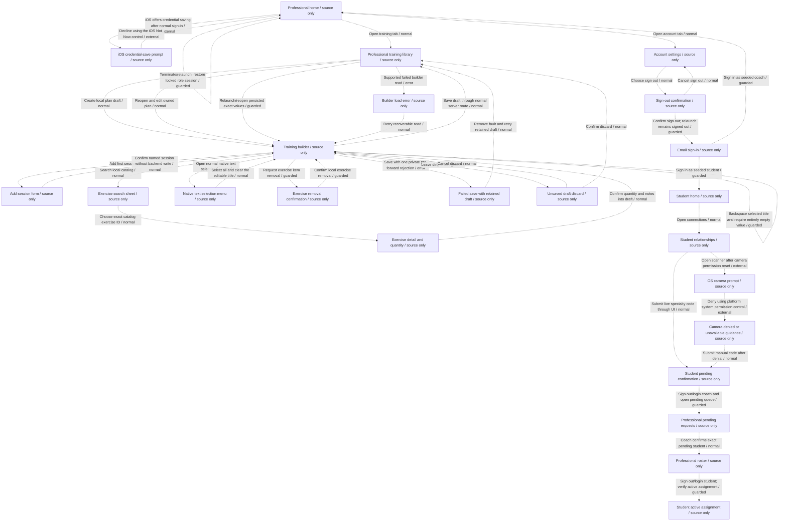
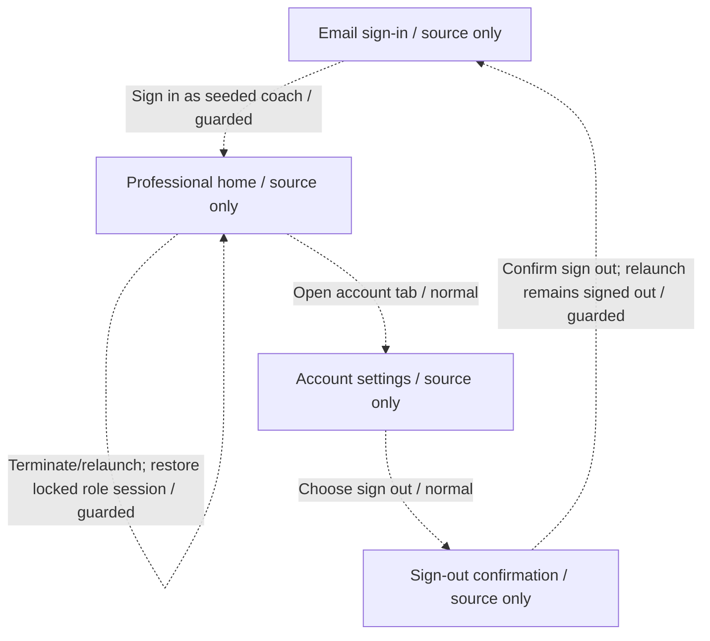
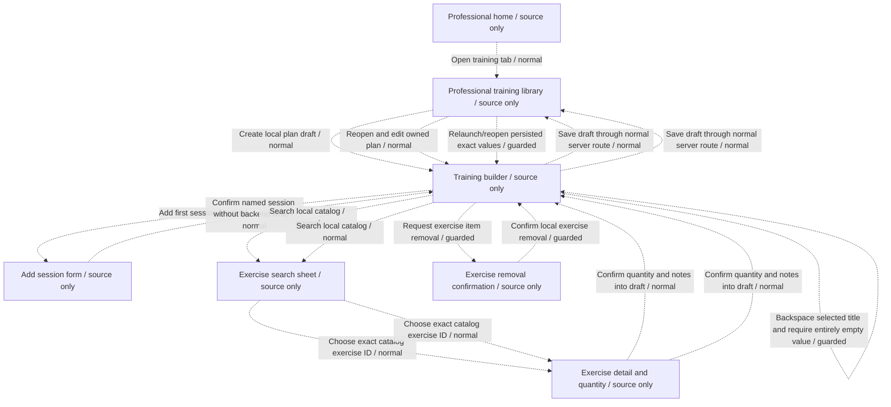
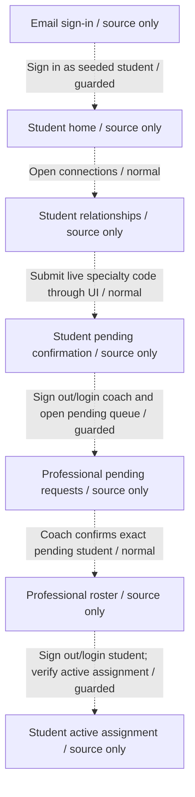
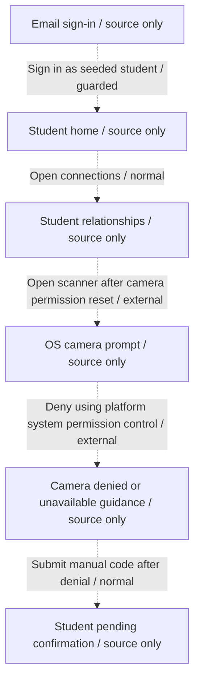
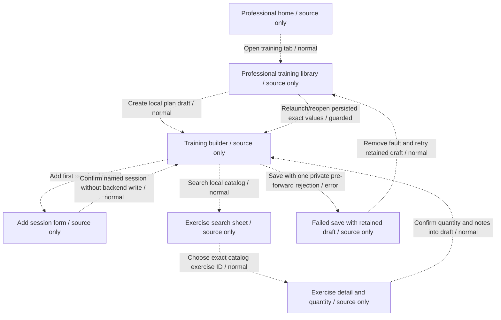

# Native pilot source flowcharts

Generated with `generate-native-declaration.py`. Every node and edge is declared only; local runtime receipts are not imported into this portable graph. These diagrams are not test results. The overview retains recovery candidates and the iOS credential-save setup branch outside the five core baseline paths.

## Overview

## session

## training

## connection

## camera-denied

## save-retry

